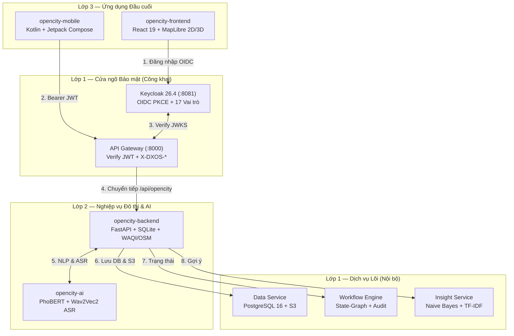
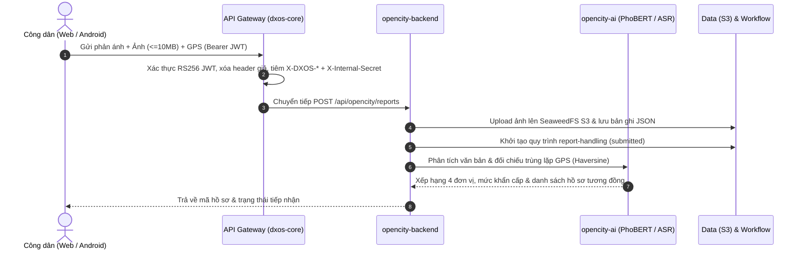
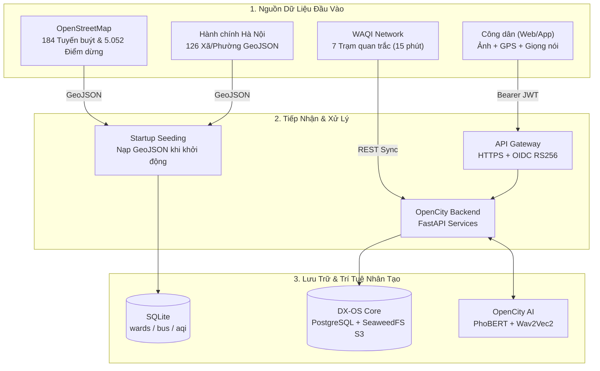

<!-- Copyright 2026 HouHackathon-CHP. Licensed under the Apache License, Version 2.0. -->

<div align="center">


# Nền Tảng Đô Thị Thông Minh Mở (OpenCity & DX-OS)

> **"Hạ tầng lõi tách bạch — Dữ liệu mở minh bạch — Trí tuệ nhân tạo phục vụ công dân"**

<p>
  <a href="https://opencity.id.vn/"></a>
  <a href="https://houhackathon-chp.github.io/opencity-documents/"></a>
  <a href="https://github.com/HouHackathon-CHP/dxos-core"></a>
  <a href="https://github.com/HouHackathon-CHP/opencity-backend"></a>
  <a href="https://github.com/HouHackathon-CHP/opencity-ai"></a>
  <a href="https://github.com/HouHackathon-CHP/opencity-frontend"></a>
  <a href="https://github.com/HouHackathon-CHP/opencity-mobile"></a>
  <a href="../LICENSE"></a>
</p>

**Ngôn ngữ:** **Tiếng Việt** | [English](README_EN.md)

---

### Sứ Mệnh

**Chuẩn hóa** hạ tầng lõi chuyển đổi số | **Minh bạch hóa** dữ liệu đô thị | **Kết nối** công dân và đơn vị vận hành

**Cổng Web Chính thức:** [https://opencity.id.vn/](https://opencity.id.vn/) &bull; **Tài liệu Kỹ thuật:** [https://houhackathon-chp.github.io/opencity-documents/](https://houhackathon-chp.github.io/opencity-documents/)

</div>

---

## Về Dự Án

**OpenCity & DX-OS** (phát triển bởi **HouHackathon-CHP** cho **OLP 2026**) không chỉ là một cổng thông tin điện tử đơn lẻ — đây là **hệ sinh thái phần mềm đô thị thông minh mã nguồn mở** kết hợp hạ tầng lõi đa tenant (*headless open-core*), trí tuệ nhân tạo xử lý ngôn ngữ tự nhiên tiếng Việt, bản đồ GIS 2D/3D và dữ liệu quan trắc mở theo thời gian thực.

### Bối Cảnh & Bài Toán Đặt Ra

Quá trình chuyển đổi số đô thị tại nhiều địa phương thường gặp 4 nút thắt lớn:

- **Hệ thống rời rạc, khó tái sử dụng:** Mỗi ứng dụng công dân mới đều phải tự xây lại đăng nhập, phân quyền, cổng API, lưu trữ ảnh và quy trình xử lý hồ sơ từ đầu.
- **Thiếu tách bạch giữa lõi và nghiệp vụ:** Logic đặc thù của từng lĩnh vực bị trộn lẫn vào hạ tầng nền tảng, khiến việc mở rộng sang địa phương khác (`multi-tenancy`) tốn nhiều công sức.
- **Xử lý phản ánh hiện trường thủ công:** Cán bộ điều phối mất nhiều thời gian đọc, phân loại đơn vị phụ trách, phát hiện phản ánh trùng lặp và theo dõi hạn xử lý SLA.
- **Dữ liệu môi trường và giao thông phân tán:** Người dân khó tra cứu tập trung chỉ số chất lượng không khí (VN-AQI), ranh giới hành chính cấp xã/phường, tuyến xe buýt và tiện ích công cộng trên cùng một nền tảng.

### Giải Pháp Của Chúng Tôi

**OpenCity & DX-OS** giải quyết triệt để các bài toán trên dựa trên **3 trụ cột kiến trúc**:

- **Hạ Tầng Lõi Headless (`DX-OS Core`):** Định danh SSO 17 vai trò, API Gateway `RS256`, lưu trữ PostgreSQL + SeaweedFS S3, Workflow Engine và Insight độc lập hoàn toàn với nghiệp vụ.
- **Nghiệp Vụ Đô Thị & AI Tiếng Việt:** Điều phối phản ánh SLA khép kín, phân loại và chấm mức độ khẩn cấp bằng PhoBERT Multi-Task, chuyển giọng nói thành văn bản (Wav2Vec2 ASR), đồng bộ WAQI & OSM.
- **Trải Nghiệm Đa Nền Tảng (Web & Android):** Cổng Web 2D/3D (60 khái niệm dịch vụ, 23 luồng end-to-end) và ứng dụng Android bản địa hỗ trợ gửi ảnh/GPS, bản nháp offline.

> **Tuyên bố Mã nguồn mở:** Dự án được thiết kế theo mô hình *service-hub* nguồn mở (**Apache License 2.0**), sử dụng dữ liệu mở (OpenStreetMap, WAQI) và dữ liệu thử nghiệm `[DEMO]`, không gắn nhãn hiệu hay kết nối trực tiếp vào hệ thống nội bộ của cơ quan nhà nước.

---

## Kiến Trúc Hệ Thống

### Thiết Kế Phân Tách 3 Tầng Nghiêm Ngặt

Hệ sinh thái tuân thủ mô hình **Strict 3-Layer Architecture** với ranh giới mạng rõ ràng: chỉ **Keycloak (`:8081`)**, **API Gateway (`:8000`)** và **Web Portal** mở ra bên ngoài; toàn bộ dịch vụ lõi, cơ sở dữ liệu, backend nghiệp vụ và AI đều nằm ẩn trong mạng nội bộ Docker.



### Điểm Độc Đáo Trong Thiết Kế

#### 1. Tách Bạch Tuyệt Đối Lõi & Nghiệp Vụ (Headless Open-Core)
- **`dxos-core` (Lớp 1)** tuyệt đối không chứa từ khóa hay quy tắc riêng của OpenCity (như *"ổ gà"*, *"xe buýt"*, *"AQI"*).
- Khi triển khai cho một địa phương mới (multi-tenancy), chỉ cần tạo thêm `tenant_id` trong Keycloak; dữ liệu phản ánh, thông báo và lịch hẹn tự động cô lập theo `X-DXOS-Tenant`.
- Khi tích hợp thêm ứng dụng mới ngoài OpenCity, chỉ cần đăng ký vào biến `EXTRA_UPSTREAMS` của API Gateway.

#### 2. Bảo Mật Zero-Trust Qua Gateway (`X-DXOS-*` & `X-Internal-Secret`)
- **Chống giả mạo header:** API Gateway **xóa sạch** mọi header `X-DXOS-*` do client gửi lên, chỉ gắn lại sau khi xác thực thành công chữ ký JWT `RS256` từ Keycloak kèm mật khẩu nội bộ `X-Internal-Secret` (kiểm tra bằng `hmac.compare_digest`).
- **Chặn gọi tắt vào Lõi:** `dxos-web` và `dxos-mobile` chỉ được gọi `/api/opencity/*`; mọi request gọi thẳng vào `/api/data/*` hay `/api/workflow/*` đều bị từ chối với mã `403`.
- **Cô lập theo đơn vị (`unit_id`):** Cán bộ `reports_operator` chỉ thấy hồ sơ thuộc `unit_id` của mình; ngay khi hồ sơ được chuyển đơn vị, quyền xem của đơn vị cũ tự động bị thu hồi.

#### 3. Luồng Xử Lý Phản Ánh Khép Kín 4 Bước


#### 4. Trí Tuệ Nhân Tạo Tiếng Việt Chuyên Sâu (`opencity-ai`)
- **PhoBERT Multi-Task (`vinai/phobert-base-v2`):** Chạy 1 mô hình xương sống duy nhất (tiền huấn luyện trên 20GB văn bản tiếng Việt) gắn với **3 đầu ra song song** (phân loại 4 đơn vị, dự đoán 3 mức khẩn cấp, phát hiện trùng lặp ngữ nghĩa + GPS Haversine), tối ưu RAM/GPU.
- **Wav2Vec2 Vietnamese ASR:** Tiền huấn luyện trên 13.000 giờ giọng nói tiếng Việt (Apache 2.0), hỗ trợ `WebM`, `WAV`, `MP3`, `OGG`, `M4A` để người dân nói trực tiếp khi gửi phản ánh.

---

## Cấu Trúc 6 Repository Trong Hệ Sinh Thái

#### 1. Hạ Tầng Lõi (Layer 1) — [dxos-core](https://github.com/HouHackathon-CHP/dxos-core)


Headless Core Platform gồm 6 dịch vụ lõi (`:8000` Gateway, `:8081` Keycloak), kiểm thử bằng `pytest`, `smoke.py` và License Audit.

```text
dxos-core/
├─ identity/   Keycloak 26.4.0 + PostgreSQL (dxos_identity)
├─ gateway/    FastAPI + PyJWT RS256 + CORS + Public GET
├─ data/       FastAPI + SQLAlchemy + SeaweedFS S3 (dxos_data)
├─ workflow/   JSON State-Graph Engine (dxos_workflow)
├─ insight/    Multinomial Naive Bayes + TF-IDF Cosine
└─ scripts/    smoke.py & check_direct_licenses.py
```

- Định danh tập trung OIDC + PKCE `S256` (`dxos-web`, `dxos-mobile`, `dxos-cli`).
- Cổng biên duy nhất `:8000` xác thực JWT và định tuyến `EXTRA_UPSTREAMS`.
- Lưu trữ bản ghi JSON đa tenant kèm lịch sử sửa đổi bất biến (`history`).
- Kho đối tượng S3 (`SeaweedFS 4.48`) lưu ảnh hiện trường trong bucket `dxos-objects`.
- Máy trạng thái quy trình `report-handling` (`submitted` → `assigned` → `in_progress` → `transfer_requested` → `resolved`).

---

#### 2. API Nghiệp Vụ Đô Thị (Layer 2) — [opencity-backend](https://github.com/HouHackathon-CHP/opencity-backend)


Domain API Orchestration với 17 vai trò RBAC (`smoke_app.py`), dữ liệu mở WAQI + 126 xã/phường + 184 tuyến buýt OSM, tài liệu Swagger tại `/api/opencity/docs`.

```text
opencity-backend/
├─ app/api/routes/   Tiếp nhận HTTP & kiểm tra quyền RBAC
├─ app/schemas/      Khuôn mẫu dữ liệu Pydantic v2
├─ app/services/     SLA, đồng bộ WAQI, tìm tuyến OSM
├─ app/repositories/ SQLite & client gọi DX-OS Core
└─ data/             wards_boundaries.geojson, bus_osm.geojson, tourism_osm.geojson
```

- Điều phối phản ánh hiện trường, gợi ý phân luồng AI & SLA Dashboard (`/reports/dashboard`).
- Đồng bộ WAQI (`api.waqi.info`) mỗi 15 phút cho 7 trạm trọng điểm Hà Nội.
- Nạp và phục vụ GeoJSON 126 xã/phường Hà Nội (`wards.sqlite3`).
- Tìm tuyến xe buýt trực tiếp/chuyển tuyến (184 tuyến, 5.052 điểm dừng) & tính lộ trình đi bộ + $\text{CO}_2$ tiết kiệm.
- Hành chính công: thông báo, đường dây nóng, tin tức, khảo sát, đặt lịch hẹn, phản ánh TTHC & kiến nghị doanh nghiệp.

---

#### 3. Microservice Trí Tuệ Nhân Tạo (Layer 2) — [opencity-ai](https://github.com/HouHackathon-CHP/opencity-ai)


Vietnamese NLP Multi-Task & Speech Recognition (Apache-2.0 / MIT / BSD), hỗ trợ CUDA GPU & CPU fallback, nhận âm thanh `WebM`, `WAV`, `MP3`, `OGG`, `M4A`.

```text
opencity-ai/
├─ app/main.py       FastAPI entrypoint + trang test ASR tại GET /
├─ app/api/routes/   GET /health, POST /analyze, voice-transcribe
├─ app/services/     PhoBERT Multi-Task & Wav2Vec2 Vietnamese ASR
└─ scripts/          check_direct_licenses.py
```

- **Head 1 (Phân loại đơn vị):** Ánh xạ 12 nhóm sự cố dân sinh về 4 đơn vị (`infrastructure`, `environment`, `transport`, `intake`).
- **Head 2 (Mức độ khẩn cấp):** Phát hiện sự cố nguy hiểm (`high`, `normal`, `low`).
- **Head 3 (Phát hiện trùng lặp):** L2-Normalized Sentence Embeddings + khoảng cách GPS Haversine + độ trễ thời gian.
- **Wav2Vec2 Vietnamese ASR:** Chuyển ghi âm thành văn bản tiếng Việt và tự gợi ý tiêu đề + danh mục.

---

#### 4. Cổng Web Công Dân & Điều Hành 2D/3D (Layer 3) — [opencity-frontend](https://github.com/HouHackathon-CHP/opencity-frontend)


Đang vận hành tại **[opencity.id.vn](https://opencity.id.vn/)** với 60 khái niệm dịch vụ (23 luồng end-to-end) và xác thực OIDC + PKCE (`S256`).

```text
opencity-frontend/
├─ src/pages/        Service Hub, Bản đồ 2D/3D, SLA Dashboard, Admin
├─ src/services/     catalog.json (60 khái niệm dịch vụ), API clients
├─ src/auth/         oidc-client-ts (PKCE S256 với dxos-web)
└─ scripts/          check:catalog & check:licenses
```

- Danh mục 60 khái niệm dịch vụ đô thị (12 nhóm, tìm kiếm không dấu, 23 luồng kết nối end-to-end).
- Bản đồ tương tác MapLibre GL 2D/3D (nghiêng góc nhìn, đùn khối công trình): Không khí (`/air-quality`), 126 Xã/Phường (`/ward-map`), Xe buýt (`/bus-search`), Bãi đỗ xe (`/parking`), Bản đồ Phản ánh (`/reports/map`), Du lịch/Di tích/Y tế/Giáo dục.
- Giao diện điều hành động theo `GET /api/opencity/me/capabilities` & SLA Dashboard (`/reports/dashboard`).

---

#### 5. Ứng Dụng Android Công Dân (Layer 3) — [opencity-mobile](https://github.com/HouHackathon-CHP/opencity-mobile)


Native Kotlin & Jetpack Compose Citizen App (JDK 21, Gradle 8.11.1, `AppAuth` + `Android Keystore`, HTTPS-only release).

```text
opencity-mobile/
├─ app/src/main/     Jetpack Compose (Material 3) UI & ViewModels
├─ auth/             AppAuth OIDC + PKCE (opencity://auth) & Android Keystore
├─ map/              MapLibre Native (chọn GPS, xem tin cảnh báo)
└─ draft/            Lưu trữ bản nháp phản ánh cục bộ (offline drafts)
```

- Đăng nhập & tự đăng ký công dân (`prompt=create`) trực tiếp qua Keycloak, mã hóa token bằng `Android Keystore`.
- Gửi phản ánh hiện trường kèm ảnh từ camera/thư viện, ghim tọa độ GPS và lưu bản nháp offline khi mất mạng.
- Theo dõi tiến độ xử lý & hộp thư thông báo (`/notifications`).
- Khảo sát cộng đồng, đặt lịch tiếp công dân, phản ánh TTHC và gọi nhanh từ danh bạ đường dây nóng.

---

#### 6. Cổng Tài Liệu Kỹ Thuật (Docs Portal) — [opencity-documents](https://github.com/HouHackathon-CHP/opencity-documents)


Đang xuất bản tại **[GitHub Pages](https://houhackathon-chp.github.io/opencity-documents/)** với đầy đủ 11 trang Tiếng Việt & 11 trang Tiếng Anh đối chiếu 1-1.

```text
opencity-documents/
├─ docs/             11 trang tài liệu Tiếng Việt (Tổng quan → Vận hành)
├─ docs/en/          11 trang tài liệu Tiếng Anh đối chiếu 1-1
├─ overrides/        Landing Parallax 3D, Bento Grid, chuyển ngôn ngữ giữ trang
└─ .github/workflows/ Build & deploy tự động lên GitHub Pages
```

- Tài liệu song ngữ Việt/Anh đầy đủ 1-1 cho cả 6 repository.
- Hướng dẫn cài đặt Local Stack từng bước, danh sách 17 tài khoản kiểm thử, sơ đồ kiến trúc Mermaid và tài liệu bảo mật RBAC.
- Tự động kiểm tra `mkdocs build --strict` và xuất bản lên GitHub Pages.

---

## Dữ Liệu Mở & Data Pipeline

### Nguồn Dữ Liệu & Luồng Đồng Bộ



| Nguồn | Loại Dữ Liệu | Phương Thức | Tần Suất |
| --- | --- | --- | --- |
| **WAQI (`api.waqi.info`)** | VN-AQI, $\text{PM}_{2.5}$, $\text{PM}_{10}$, nhiệt độ, độ ẩm, CO, $\text{NO}_2$, $\text{O}_3$, $\text{SO}_2$ tại 7 trạm Hà Nội | REST Sync theo tọa độ GPS | Tự động mỗi 15 phút & đồng bộ tức thì qua `POST /air-quality/sync` |
| **OpenStreetMap (`bus_osm.geojson`)** | 184 tuyến xe buýt, 5.052 điểm dừng, lộ trình đi bộ & ước tính $\text{CO}_2$ | GeoJSON nạp vào SQLite | Tự động khi khởi động backend |
| **Ranh giới Hành chính (`wards_boundaries.geojson`)** | Đa giác ranh giới, diện tích, dân số ước tính, trụ sở & đường dây nóng của 126 xã/phường | GeoJSON nạp vào `wards.sqlite3` | Tự động khi khởi động backend |
| **Du lịch & Tiện ích (`tourism_osm.geojson`)** | Điểm du lịch, di tích, bãi đỗ xe, bệnh viện, nhà thuốc, trường học | GeoJSON / SQLite | Tự động khi khởi động & CRUD quản trị |
| **Công dân & Cán bộ** | Phản ánh hiện trường (ảnh $\le 10\text{ MB}$ + GPS), ghi âm giọng nói, đặt lịch hẹn, khảo sát | API qua Gateway (`RS256` JWT) | Thời gian thực |

---

## Tính Năng Chính Theo Nhóm Người Dùng

### Dành Cho Công Dân (Web Portal & Android App)

| Tính Năng | Mô Tả Chi Tiết |
| --- | --- |
| **Danh mục 60 Dịch vụ Đô thị** | Chia thành 12 nhóm danh mục, hỗ trợ tìm kiếm tiếng Việt không dấu, lưu yêu thích cục bộ, với 23 dịch vụ vận hành end-to-end |
| **Phản ánh Hiện trường & Bản đồ Nóng** | Gửi phản ánh kèm ảnh chụp, ghim GPS hoặc nói qua mic (Wav2Vec2 ASR); hỗ trợ lưu bản nháp offline trên Android |
| **Quan trắc Không khí (`/air-quality`)** | Theo dõi VN-AQI, $\text{PM}_{2.5}$, $\text{PM}_{10}$ và biểu đồ 24h tại 7 trạm Hà Nội kèm khuyến nghị sức khỏe theo QCVN |
| **Bản đồ 126 Xã/Phường (`/ward-map`)** | Chuyển đổi góc nhìn 2D/3D, tô sáng ranh giới khi chọn, tìm nhanh theo quận/huyện và xem thông tin liên hệ |
| **Xe buýt & Tìm đường (`/bus-search`)** | Tra cứu 184 tuyến và 5.052 điểm dừng, tìm tuyến trực tiếp hoặc chuyển tuyến, chỉ đường đi bộ và tính $\text{CO}_2$ tiết kiệm |
| **Tiện ích & Hành chính Công** | Bãi đỗ xe, Du lịch/Di tích, Y tế/Giáo dục, Đường dây nóng, Tin cảnh báo, Khảo sát, Đặt lịch tiếp công dân, Phản ánh TTHC & Kiến nghị doanh nghiệp |

### Dành Cho Cán Bộ Điều Hành & Quản Trị Viên

| Tính Năng | Mô Tả Chi Tiết |
| --- | --- |
| **Phân quyền RBAC 17 Vai trò** | `admin`, `reports_dispatcher`, `reports_operator` (theo `unit_id`: `infrastructure`, `environment`, `transport`, `intake`) cùng 13 vai trò chuyên trách từng phân hệ |
| **SLA Dashboard (`/reports/dashboard`)** | Thống kê thời gian thực hồ sơ mới, đang xử lý, sắp đến hạn 24h, quá hạn và tải công việc của từng đơn vị |
| **Gợi ý Phân luồng AI** | Endpoint `/reports/{id}/triage-suggestion` kết hợp Insight & PhoBERT để xếp hạng đơn vị thụ lý và cảnh báo trùng lặp GPS |
| **Quản trị Môi trường & Địa bàn** | Thêm/sửa/ẩn trạm quan trắc, kích hoạt đồng bộ WAQI tức thì, phát cảnh báo ô nhiễm và cập nhật hồ sơ 126 xã/phường |

---

## Tech Stack Chi Tiết

<details>
<summary><b>Lớp 1 — DX-OS Core (Keycloak, API Gateway, Data, Workflow, Insight)</b></summary>

- **Identity & SSO:** Keycloak `26.4.0`, PostgreSQL (`dxos_identity`), OIDC Authorization Code + PKCE `S256` (`dxos-web`, `dxos-mobile`, `dxos-cli`)
- **API Gateway:** Python `3.12`, FastAPI, Uvicorn, `httpx`, `PyJWT` (`RS256` JWKS verification), CORS, `PUBLIC_GET_ROUTES`, `EXTRA_UPSTREAMS`
- **Data & Object Storage:** FastAPI, SQLAlchemy, PostgreSQL `16` (`dxos_data`), `boto3`, SeaweedFS `4.48` (S3 bucket `dxos-objects`)
- **Workflow & Insight:** FastAPI, PostgreSQL (`dxos_workflow`), JSON State-Graph (`definitions/report-handling.json`), Multinomial Naive Bayes + TF-IDF Cosine

</details>

<details>
<summary><b>Lớp 2 — OpenCity Backend & OpenCity AI</b></summary>

- **Backend API:** Python `3.12`, FastAPI `0.158`, Pydantic v2, `httpx`, SQLite (`wards.sqlite3`, `opencity.db`), GeoJSON (`126` wards, `184` bus routes / `5,052` stops, tourism/heritage)
- **AI Microservice:** Python `3.11+`, FastAPI, PyTorch, HuggingFace Transformers (`vinai/phobert-base-v2`, `Wav2Vec2 Vietnamese`), Haversine geospatial deduplication
- **Testing & Audit:** `pytest`, `smoke.py`, `smoke_app.py`, `seed_dashboard_demo.py`, `scripts/check_direct_licenses.py`

</details>

<details>
<summary><b>Lớp 3 — OpenCity Web Portal & Android Mobile App</b></summary>

- **Web Portal (`opencity-frontend`):** React `19`, TypeScript `5.7`, Vite `6.0`, MapLibre GL JS `6.16` (2D/3D), `oidc-client-ts`, `npm run check:catalog`, `npm run check:licenses`
- **Mobile App (`opencity-mobile`):** Kotlin, Jetpack Compose (Material 3), `AppAuth` (OIDC + PKCE `opencity://auth`), `Android Keystore`, MapLibre Native, Gradle `8.11.1`, JDK `21`

</details>

<details>
<summary><b>Tài liệu, CI/CD & Quản trị Mã nguồn Mở</b></summary>

- **Documentation (`opencity-documents`):** MkDocs, Material for MkDocs, `pymdown-extensions`, Mermaid, bilingual VI/EN (`1-1` parity)
- **CI/CD & Automation:** GitHub Actions (`ci.yml`, `changelog.yml`, `docs.yml`), `orhun/git-cliff-action@v4` + `cliff.toml` (Conventional Commits), GitHub Pages
- **License:** Apache License 2.0 across all 6 repositories

</details>

---

## Quy Trình CI/CD & Tự Động Hóa

Tất cả repository trong hệ sinh thái `HouHackathon-CHP` đều tích hợp **GitHub Actions** để kiểm soát chất lượng tự động:

```mermaid
flowchart TB
    DEV["Developer\nPush / Pull Request (dev / main)"]
    DEV -->|Mọi PR / Push| CI["ci.yml\nUnit Tests + License Audit + Build Check"]
    DEV -->|Merge main / Tag| CL["changelog.yml\ngit-cliff tự sinh CHANGELOG.md"]
    DEV -->|Push main (opencity-documents)| DOCS["docs.yml\nmkdocs build --strict to gh-pages"]
```

- **Kiểm thử & Kiểm toán Giấy phép (`ci.yml`):** Chạy `pytest`, `check_direct_licenses.py`, `npm run check:catalog`, `npm run check:licenses` và `npm run build` tự động trên mỗi PR.
- **Tự động hóa `CHANGELOG.md` (`changelog.yml`):** Sử dụng `git-cliff` và cấu hình `cliff.toml` chuẩn tiếng Việt để gom nhóm các commit theo chuẩn **Conventional Commits** (`feat:`, `fix:`, `docs:`, `refactor:`, `perf:`, `test:`, `ci:`).
- **Xuất bản Tài liệu (`docs.yml`):** Tự động build `mkdocs build --strict` và triển khai lên [GitHub Pages](https://houhackathon-chp.github.io/opencity-documents/).

---

## Bảng Tra Cứu Nhanh API Chính (Tiền tố `/api/opencity`)

Tài liệu tương tác đầy đủ có tại `http://localhost:8000/api/opencity/docs` (Swagger UI) và `http://localhost:8000/api/opencity/redoc` (ReDoc) khi chạy Local Stack:

| Nhóm | Phương Thức & Đường Dẫn | Quyền Yêu Cầu | Mô Tả |
| --- | --- | --- | --- |
| **Hệ thống** | `GET /health` | Công khai | Kiểm tra trạng thái hoạt động của backend |
| **Phân quyền** | `GET /me/capabilities` | Đã đăng nhập | Lấy danh sách vai trò, `unit_id` và quyền giao diện của user |
| **Phản ánh** | `GET`, `POST /reports` | Đã đăng nhập | Xem danh sách hoặc tạo phản ánh mới kèm ảnh ($\le 10\text{ MB}$) & GPS |
| **Gợi ý AI** | `GET /reports/{id}/triage-suggestion` | `reports_dispatcher` / `admin` | Gợi ý đơn vị thụ lý, mức khẩn cấp & cảnh báo trùng lặp GPS |
| **Giọng nói AI** | `POST /reports/voice-transcribe` | Đã đăng nhập | Chuyển âm thanh tiếng Việt thành văn bản & gợi ý tiêu đề/danh mục |
| **Điều phối** | `POST /reports/{id}/assign` | `reports_dispatcher` / `admin` | Gán `unit_id` và hạn xử lý SLA `due_at` |
| **Xử lý** | `POST /reports/{id}/accept`, `/progress`, `/actions/resolve` | `reports_operator` | Cập nhật tiến độ xử lý theo đúng `unit_id` |
| **SLA Dashboard** | `GET /reports/dashboard` | `reports_dispatcher` / `admin` | Thống kê SLA (mới, đang xử lý, sắp đến hạn 24h, quá hạn) |
| **Không khí** | `GET /air-quality/summary`, `/stations` | Công khai | Chỉ số VN-AQI và dữ liệu 7 trạm quan trắc Hà Nội |
| **Đồng bộ WAQI** | `POST /air-quality/sync` | `air_quality_operator` / `admin` | Kéo số liệu mới nhất từ mạng lưới `api.waqi.info` |
| **Xã/Phường** | `GET /wards`, `/wards/{id}` | Công khai | Danh sách & GeoJSON ranh giới 126 xã/phường Hà Nội |
| **Xe buýt OSM** | `GET /bus/routes`, `/bus/stops`, `/bus/find`, `/bus/walk-route` | Công khai | Tra cứu 184 tuyến, 5.052 điểm dừng & tìm lộ trình tối ưu |
| **Hành chính** | `GET`, `POST /appointments`, `/administrative-feedback`, `/business-feedback` | Đã đăng nhập | Đặt lịch tiếp công dân & gửi phản ánh TTHC / doanh nghiệp |

---

## Hướng Dẫn Bắt Đầu Nhanh (Local Stack)

### Yêu Cầu Hệ Thống
- **Docker Desktop / Docker Engine** (Linux containers)
- **Python 3.10+** (`3.12` khuyến nghị)
- **Node.js 20+** (kèm `npm`)
- **Android Studio & JDK 21** (Gradle `8.11.1`, tùy chọn nếu build app Android)

Đặt toàn bộ các repository ngang hàng trong cùng một thư mục gốc:

```text
HouHackathon-CHP/
├── dxos-core/
├── opencity-backend/
├── opencity-ai/
├── opencity-frontend/
├── opencity-mobile/
└── opencity-documents/
```

### 1. Khởi Chạy Core & Backend Stack (Docker Compose)

```powershell
# 1. Tạo tệp môi trường cho dxos-core (tùy chọn điền WAQI_API_TOKEN để đồng bộ AQI trực tiếp)
Copy-Item dxos-core\.env.example dxos-core\.env

# 2. Khởi chạy toàn bộ container (Keycloak, Gateway, PostgreSQL, SeaweedFS, Core Services, OpenCity Backend)
cd opencity-backend
docker compose --env-file ..\dxos-core\.env -f ..\dxos-core\compose.yaml -f compose.stack.yaml up --build -d

# 3. Kiểm tra trạng thái container
docker compose --env-file ..\dxos-core\.env -f ..\dxos-core\compose.yaml -f compose.stack.yaml ps

# 4. Chạy các script khởi tạo (idempotent — an toàn khi chạy lại)
python ..\dxos-core\scripts\smoke.py          # Tạo người dùng mẫu & mapper tenant_id
python scripts\smoke_app.py                     # Cấp phát 17 tài khoản vai trò & test API
python scripts\seed_dashboard_demo.py           # (Tùy chọn) Nạp 5 hồ sơ SLA demo trên bản đồ Hà Nội
```

### 2. Khởi Chạy Dịch Vụ AI (`opencity-ai`) — Tùy Chọn Độc Lập

```bash
cd opencity-ai
python -m venv .venv
source .venv/bin/activate  # Hoặc .venv\Scripts\activate trên Windows
pip install -r requirements.txt -r requirements-dev.txt
uvicorn app.main:app --host 0.0.0.0 --port 8000 --reload
```

### 3. Khởi Chạy Web Portal (`opencity-frontend`)

```powershell
cd ..\opencity-frontend
Copy-Item .env.example .env.local
npm ci
npm run check:catalog
npm run check:licenses
npm run dev
```

- **Web Portal:** `http://localhost:3000` *(luôn dùng `localhost`, không dùng `127.0.0.1` do cấu hình origin OIDC `dxos-web`)*
- **API Gateway & Swagger Docs:** `http://localhost:8000/api/opencity/docs`
- **Keycloak Admin Console:** `http://localhost:8081`

### 4. Kết Nối Android Emulator (`opencity-mobile`)

```powershell
$adb = "$env:LOCALAPPDATA\Android\Sdk\platform-tools\adb.exe"
& $adb reverse tcp:8081 tcp:8081
& $adb reverse tcp:8000 tcp:8000
```

Sau đó mở `opencity-mobile` trong **Android Studio** (JDK 21) và bấm **Run** (hoặc `./gradlew.bat :app:installDebug`).

### 5. Tài Khoản Kiểm Thử Theo Vai Trò

Mật khẩu nằm trong `dxos-core/.env` (xem đầy đủ **17 tài khoản** tại [Hướng dẫn Cài đặt Local](https://houhackathon-chp.github.io/opencity-documents/getting-started/local-setup/)):

| Tài khoản | Biến Môi Trường | Vai trò (`role`) | Phạm Vi Truy Cập |
| --- | --- | --- | --- |
| `dxos-citizen` | `DEMO_CITIZEN_PASSWORD` | `citizen` | Gửi phản ánh, đặt lịch, khảo sát, TTHC & kiến nghị |
| `dxos-admin` | `DEMO_ADMIN_PASSWORD` | `admin` | Quản trị toàn hệ thống (`/admin`) & mọi phân hệ |
| `dxos-dispatcher` | `DEMO_DISPATCHER_PASSWORD` | `reports_dispatcher` | Điều phối viên tiếp nhận, giao `unit_id` & SLA Dashboard |
| `dxos-reports` | `DEMO_REPORTS_PASSWORD` | `reports_operator` | Cán bộ xử lý phản ánh khối Hạ tầng (`unit_id=infrastructure`) |
| `dxos-reports-environment` | `DEMO_REPORTS_ENVIRONMENT_PASSWORD` | `reports_operator` | Cán bộ xử lý phản ánh khối Môi trường (`unit_id=environment`) |
| `dxos-air-quality` | `DEMO_AIR_QUALITY_PASSWORD` | `air_quality_operator` | Quản lý trạm quan trắc, đồng bộ WAQI & phát cảnh báo |
| `dxos-digital-ward` | `DEMO_DIGITAL_WARD_PASSWORD` | `digital_ward_operator` | Quản lý hồ sơ 126 xã/phường & bản đồ số |

---

## Đóng Góp & Bảo Mật

Chúng tôi hoan nghênh mọi đóng góp từ cộng đồng theo tinh thần mã nguồn mở (**Contributor Covenant v2.0**):

1. **Fork** repository bạn muốn đóng góp và tạo nhánh từ `dev` (hoặc `main`): `git checkout -b feature/ten-tinh-nang` hoặc `fix/mo-ta-loi`.
2. Thêm `# SPDX-License-Identifier: Apache-2.0` (hoặc `// SPDX-License-Identifier: Apache-2.0` cho Kotlin/TypeScript) vào đầu các tệp mã nguồn mới.
3. Chạy kiểm thử (`pytest`, `check_direct_licenses.py`, `npm run check:licenses`, `mkdocs build --strict`) trước khi gửi Pull Request.
4. Tuân thủ **Conventional Commits** (`feat:`, `fix:`, `docs:`, `refactor:`, `perf:`, `test:`, `ci:`).

### Chính Sách Bảo Mật

Nếu phát hiện lỗ hổng liên quan đến `X-Internal-Secret`, vượt qua kiểm tra JWT/RBAC/tenant hoặc lỗ hổng phụ thuộc, vui lòng **không** mở Issue công khai mà báo cáo qua **GitHub Security Advisories** hoặc email **[hotro@opencity.id.vn](mailto:hotro@opencity.id.vn)**. Chúng tôi cam kết xác nhận trong **48 giờ**, đánh giá trong **7 ngày** và vá lỗi trong **14 ngày**.

---

## Giấy Phép

Toàn bộ 6 repository thuộc **OpenCity & DX-OS** được phát hành theo **[Apache License 2.0](../LICENSE)**.

```text
Copyright 2026 HouHackathon-CHP

Licensed under the Apache License, Version 2.0 (the "License");
you may not use this file except in compliance with the License.
You may obtain a copy of the License at

    http://www.apache.org/licenses/LICENSE-2.0
```

---

## Ghi Nhận Công Nghệ & Dữ Liệu Mở

Hệ sinh thái **OpenCity & DX-OS** được xây dựng trên nền tảng các dự án mã nguồn mở và nguồn dữ liệu mở:

- **Keycloak** — Định danh & xác thực OIDC / PKCE
- **FastAPI & Pydantic** — Framework API hiệu năng cao cho Core, Backend & AI
- **PostgreSQL & SeaweedFS** — Cơ sở dữ liệu quan hệ & lưu trữ đối tượng tương thích S3
- **VinAI PhoBERT (`vinai/phobert-base-v2`) & Wav2Vec2 Vietnamese** — Mô hình NLP & nhận dạng giọng nói tiếng Việt
- **React 19, TypeScript, Vite & MapLibre GL JS / Native** — Giao diện Web 2D/3D & bản đồ di động mã nguồn mở
- **OpenStreetMap & WAQI (`api.waqi.info`)** — Dữ liệu bản đồ giao thông công cộng và quan trắc chất lượng không khí
- **MkDocs & Material for MkDocs** — Hệ thống xuất bản tài liệu kỹ thuật

---

## Đội Ngũ Phát Triển (`HouHackathon-CHP`)

Chúng tôi là những sinh viên công nghệ tại **Trường Đại học Mở Hà Nội (HOU) — Khoa Công nghệ Thông tin (FITHOU)**, xây dựng **OpenCity & DX-OS** với mong muốn đóng góp một nền tảng chuyển đổi số đô thị mở, chuẩn mực và dễ nhân rộng.

<table>
  <tr>
    <td align="center">
      <a href="https://github.com/hieutnago">
        <br>
        <sub><b>Trương Ngọc Hiểu</b></sub>
      </a><br>
      <small><i>AI &amp; MLOps Engineer</i></small>
    </td>
    <td align="center">
      <a href="https://github.com/blueMonkey23">
        <br>
        <sub><b>Trần Trọng Chiến</b></sub>
      </a><br>
      <small><i>Core &amp; Backend Architect</i></small>
    </td>
    <td align="center">
      <a href="https://github.com/ourstorycomic">
        <br>
        <sub><b>Nguyễn Hà Phương</b></sub>
      </a><br>
      <small><i>Frontend &amp; Mobile Engineer</i></small>
    </td>
  </tr>
</table>

---

## Lời Mời Hợp Tác

**OpenCity & DX-OS** là một dự án **Mã nguồn mở** hướng tới **Chuyển đổi số Đô thị bền vững**. Chúng tôi luôn chào đón sự đồng hành từ cộng đồng:

- **Backend / Core Engineer:** Cùng tối ưu API Gateway, Workflow Engine và mở rộng thêm các vertical service gắn vào `EXTRA_UPSTREAMS`.
- **AI / NLP Researcher:** Cải thiện độ chính xác mô hình phân loại sự cố đa nhiệm và nhận dạng giọng nói tiếng Việt theo từng vùng miền.
- **Frontend / Android Developer:** Nâng cấp trải nghiệm bản đồ số GIS 2D/3D và tối ưu hiệu năng ứng dụng Jetpack Compose trên các thiết bị phổ thông.
- **Địa phương & Tổ chức:** Thử nghiệm triển khai mô hình multi-tenant hoặc chia sẻ bộ dữ liệu mở để tích hợp vào nền tảng.

Vui lòng đọc tệp `CONTRIBUTING.md` trong từng repository để bắt đầu, hoặc liên hệ trực tiếp qua **[hotro@opencity.id.vn](mailto:hotro@opencity.id.vn)**.

---

<div align="center">

### OpenCity & DX-OS — Mở Hạ Tầng, Mở Dữ Liệu, Mở Tương Lai Đô Thị

*Phát triển bởi nhóm **HouHackathon-CHP** &bull; Trường Đại học Mở Hà Nội (FITHOU) &bull; OLP 2026*

</div>
