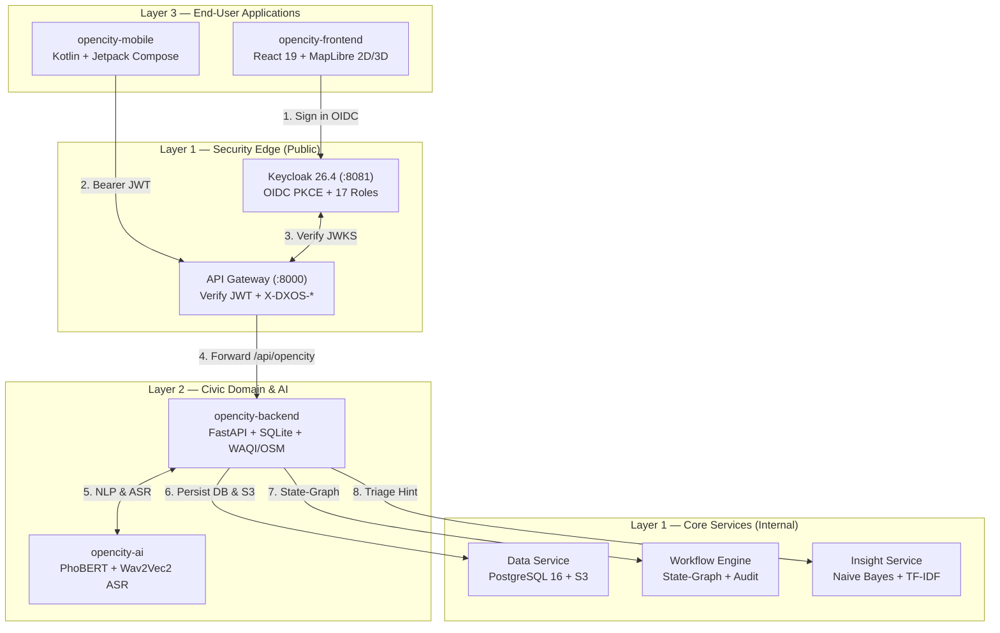
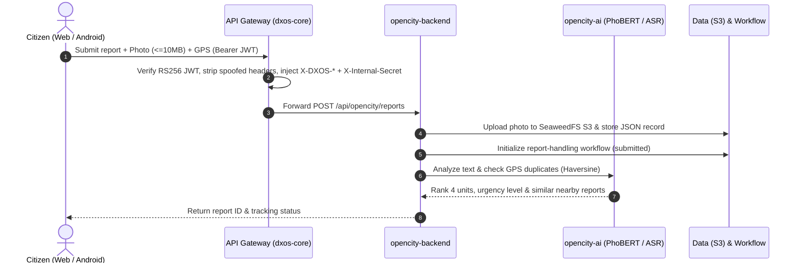
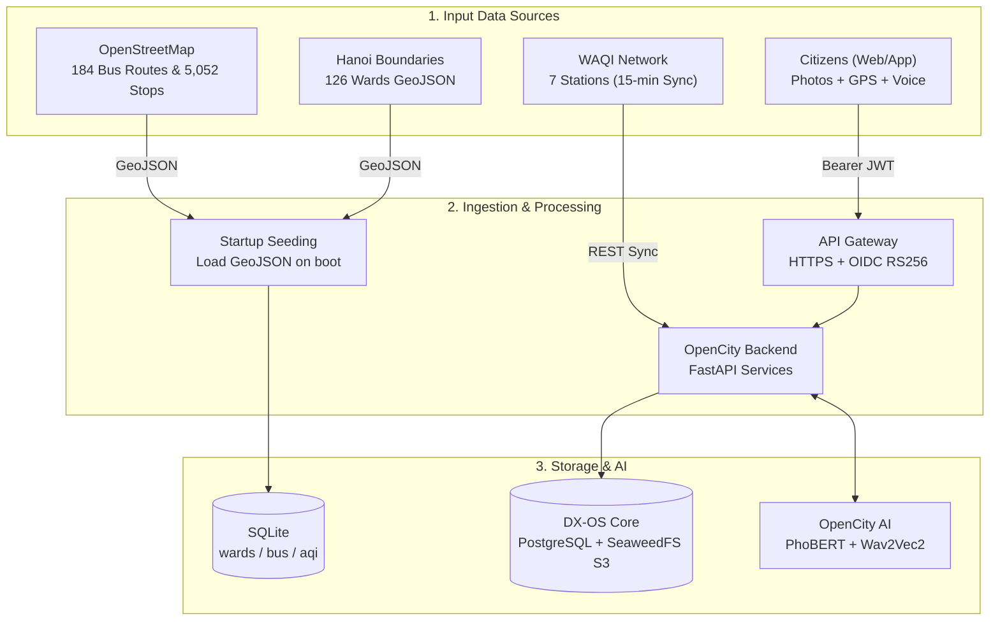

<!-- Copyright 2026 HouHackathon-CHP. Licensed under the Apache License, Version 2.0. -->

<div align="center">


# Open-Source Smart City Ecosystem (OpenCity & DX-OS)

> **"Decoupled Core Infrastructure — Transparent Open Data — Vietnamese AI for Citizens"**

<p>
  <a href="https://opencity.id.vn/"></a>
  <a href="https://houhackathon-chp.github.io/opencity-documents/en/"></a>
  <a href="https://github.com/HouHackathon-CHP/dxos-core"></a>
  <a href="https://github.com/HouHackathon-CHP/opencity-backend"></a>
  <a href="https://github.com/HouHackathon-CHP/opencity-ai"></a>
  <a href="https://github.com/HouHackathon-CHP/opencity-frontend"></a>
  <a href="https://github.com/HouHackathon-CHP/opencity-mobile"></a>
  <a href="../LICENSE"></a>
</p>

**Language:** [Tiếng Việt](README.md) | **English**

---

### Mission

**Standardize** digital transformation cores | **Open** urban environmental & transit data | **Connect** citizens and operations teams

**Official Web Portal:** [https://opencity.id.vn/](https://opencity.id.vn/) &bull; **Technical Documentation:** [https://houhackathon-chp.github.io/opencity-documents/en/](https://houhackathon-chp.github.io/opencity-documents/en/)

</div>

---

## About the Project

**OpenCity & DX-OS** (built by **HouHackathon-CHP** for **OLP 2026**) is not a single standalone web portal — it is a **modular open-source smart city software ecosystem** combining a multi-tenant headless core, Vietnamese natural language and speech AI, 2D/3D GIS mapping, and real-time open environmental telemetry.

### Context & Challenges

Urban digital transformation initiatives often face four recurring bottlenecks:

- **Fragmented infrastructure:** Every new civic application rebuilds authentication, RBAC, API routing, object storage, and workflow state tracking from scratch.
- **Tight coupling between core and domain:** Domain-specific business rules leak into platform infrastructure, making multi-city (`multi-tenant`) expansion costly.
- **Manual field-report triage:** Dispatchers spend excessive time reading citizen reports, assigning responsible units, spotting GPS duplicates, and tracking SLA deadlines.
- **Siloed urban datasets:** Citizens lack a unified interface to inspect air quality (VN-AQI), ward boundaries, public bus routes, and civic services together.

### Our Solution

**OpenCity & DX-OS** addresses these challenges on **three architectural pillars**:

- **Headless Core (`DX-OS Core`):** 17-role SSO, `RS256` API Gateway, tenant-isolated PostgreSQL + SeaweedFS S3 storage, Workflow Engine, and Insight strictly decoupled from domain rules.
- **Civic Domain & Vietnamese AI:** Closed-loop SLA report orchestration, PhoBERT Multi-Task triage and urgency scoring, Wav2Vec2 Vietnamese ASR, live WAQI sync, and OSM transit routing.
- **Multi-Platform Clients (Web & Android):** 2D/3D Web Portal (60 service concepts, 23 live end-to-end flows) and native Android app with photo/GPS capture and offline drafts.

> **Open-Source Notice:** Licensed under **Apache License 2.0** as a *service-hub* ecosystem powered by open datasets (OpenStreetMap, WAQI) and `[DEMO]` fixtures, without government branding or private internal integrations.

---

## System Architecture

### Strict 3-Layer Separation

The ecosystem enforces a **Strict 3-Layer Architecture** with clear network boundaries: only **Keycloak (`:8081`)**, **API Gateway (`:8000`)**, and the **Web Portal** are publicly exposed; all core services, databases, domain APIs, and AI engines run strictly inside the internal Docker network.



### Key Architectural Highlights

#### 1. Strict Core-Domain Decoupling (Headless Open-Core)
- **`dxos-core` (Layer 1)** must never contain OpenCity-specific keywords or rules (e.g., *"pothole"*, *"bus"*, *"AQI"*).
- Onboarding a new municipality requires only provisioning a new `tenant_id` in Keycloak; reports, notifications, and appointments isolate automatically via `X-DXOS-Tenant`.
- Attaching another vertical application alongside OpenCity only requires adding an entry to the Gateway's `EXTRA_UPSTREAMS`.

#### 2. Zero-Trust Gateway Security (`X-DXOS-*` & `X-Internal-Secret`)
- **Anti-Spoofing:** The Gateway **strips** all incoming `X-DXOS-*` headers from external clients and injects trusted identity headers only after verifying the `RS256` JWT from Keycloak, paired with `X-Internal-Secret` (validated via `hmac.compare_digest`).
- **Blocking Direct Core Access:** `dxos-web` and `dxos-mobile` may only call `/api/opencity/*`; direct calls to `/api/data/*` or `/api/workflow/*` are rejected with `403`.
- **Unit-Scoped Visibility (`unit_id`):** `reports_operator` accounts only see reports assigned to their `unit_id`; transferring a report immediately revokes access for the previous unit.

#### 3. Closed-Loop 4-Step Field Report Pipeline


#### 4. Dedicated Vietnamese AI (`opencity-ai`)
- **PhoBERT Multi-Task (`vinai/phobert-base-v2`):** Runs a single shared backbone (pre-trained on 20GB of Vietnamese text) with **3 parallel output heads** (4-unit triage, 3-level urgency, semantic + Haversine GPS duplicate detection) to minimize RAM/GPU overhead.
- **Wav2Vec2 Vietnamese ASR:** Pre-trained on 13,000 hours of Vietnamese speech (Apache 2.0), supporting `WebM`, `WAV`, `MP3`, `OGG`, and `M4A` for hands-free voice reporting.

---

## 6 Repositories Ecosystem

#### 1. Headless Core Infrastructure (Layer 1) — [dxos-core](https://github.com/HouHackathon-CHP/dxos-core)


Headless Core Platform with 6 core services (`:8000` Gateway, `:8081` Keycloak), verified with `pytest`, `smoke.py`, and License Audit.

```text
dxos-core/
├─ identity/   Keycloak 26.4.0 + PostgreSQL (dxos_identity)
├─ gateway/    FastAPI + PyJWT RS256 + CORS + Public GET
├─ data/       FastAPI + SQLAlchemy + SeaweedFS S3 (dxos_data)
├─ workflow/   JSON State-Graph Engine (dxos_workflow)
├─ insight/    Multinomial Naive Bayes + TF-IDF Cosine
└─ scripts/    smoke.py & check_direct_licenses.py
```

- Centralized OIDC + PKCE `S256` authentication (`dxos-web`, `dxos-mobile`, `dxos-cli`).
- Single edge Gateway `:8000` for JWT verification and `EXTRA_UPSTREAMS` routing.
- Tenant-isolated JSON records with immutable audit history (`history`).
- S3-compatible object storage (`SeaweedFS 4.48`) in bucket `dxos-objects`.
- State machine engine `report-handling` (`submitted` → `assigned` → `in_progress` → `transfer_requested` → `resolved`).

---

#### 2. Civic Domain API (Layer 2) — [opencity-backend](https://github.com/HouHackathon-CHP/opencity-backend)


Domain API Orchestration with 17 RBAC roles (`smoke_app.py`), open data (WAQI + 126 wards + 184 OSM bus routes), and Swagger UI at `/api/opencity/docs`.

```text
opencity-backend/
├─ app/api/routes/   HTTP request handlers & RBAC enforcement
├─ app/schemas/      Pydantic v2 data contracts
├─ app/services/     SLA logic, WAQI sync, OSM bus routing
├─ app/repositories/ SQLite & DX-OS Core clients
└─ data/             wards_boundaries.geojson, bus_osm.geojson, tourism_osm.geojson
```

- Field-report orchestration, AI triage suggestions & SLA Dashboard (`/reports/dashboard`).
- Live WAQI (`api.waqi.info`) sync every 15 minutes across 7 key Hanoi stations.
- GeoJSON boundaries & metadata for 126 Hanoi wards (`wards.sqlite3`).
- Direct/transfer bus search (184 routes, 5,052 stops), walk routing & $\text{CO}_2$ savings.
- Civic services: notifications, hotlines, bulletins, surveys, appointments, admin & business feedback.

---

#### 3. Vietnamese AI Microservice (Layer 2) — [opencity-ai](https://github.com/HouHackathon-CHP/opencity-ai)


Vietnamese NLP Multi-Task & Speech Recognition (Apache-2.0 / MIT / BSD), supporting CUDA GPU & CPU fallback and `WebM`, `WAV`, `MP3`, `OGG`, `M4A` audio.

```text
opencity-ai/
├─ app/main.py       FastAPI entrypoint + built-in ASR test UI at GET /
├─ app/api/routes/   GET /health, POST /analyze, voice-transcribe
├─ app/services/     PhoBERT Multi-Task & Wav2Vec2 Vietnamese ASR
└─ scripts/          check_direct_licenses.py
```

- **Head 1 (Unit Triage):** Maps 12 civic incident categories to 4 units (`infrastructure`, `environment`, `transport`, `intake`).
- **Head 2 (Urgency Scoring):** Detects hazardous reports (`high`, `normal`, `low`).
- **Head 3 (Duplicate Detection):** L2-Normalized Sentence Embeddings + Haversine GPS distance + time delta.
- **Wav2Vec2 Vietnamese ASR:** Transcribes voice recordings to Vietnamese text with suggested title & category.

---

#### 4. 2D/3D Web Portal & Operations Console (Layer 3) — [opencity-frontend](https://github.com/HouHackathon-CHP/opencity-frontend)


Live at **[opencity.id.vn](https://opencity.id.vn/)** with 60 service concepts (23 end-to-end live flows) and OIDC + PKCE (`S256`) authentication.

```text
opencity-frontend/
├─ src/pages/        Service Hub, 2D/3D Maps, SLA Dashboard, Admin
├─ src/services/     catalog.json (60 service concepts), API clients
├─ src/auth/         oidc-client-ts (PKCE S256 with dxos-web)
└─ scripts/          check:catalog & check:licenses
```

- 60-concept civic service catalog (12 groups, accent-insensitive Vietnamese search, 23 end-to-end live services).
- Interactive MapLibre GL 2D/3D maps (tilt/pitch, 3D building extrusions): Air Quality (`/air-quality`), 126 Wards (`/ward-map`), Bus Finder (`/bus-search`), Parking (`/parking`), Reports Map (`/reports/map`), Tourism/Heritage/Health/Education.
- Dynamic officer navigation via `GET /api/opencity/me/capabilities` & SLA Dashboard (`/reports/dashboard`).

---

#### 5. Native Android Citizen App (Layer 3) — [opencity-mobile](https://github.com/HouHackathon-CHP/opencity-mobile)


Native Kotlin & Jetpack Compose Citizen App (JDK 21, Gradle 8.11.1, `AppAuth` + `Android Keystore`, HTTPS-only release).

```text
opencity-mobile/
├─ app/src/main/     Jetpack Compose (Material 3) UI & ViewModels
├─ auth/             AppAuth OIDC + PKCE (opencity://auth) & Android Keystore
├─ map/              MapLibre Native (GPS pin selection & geo-alerts)
└─ draft/            Local offline report drafts
```

- Citizen sign-in & self-registration (`prompt=create`) via Keycloak with `Android Keystore` token encryption.
- Field report submission with camera/gallery photos, GPS coordinates, and local offline drafts.
- Resolution progress tracking & notification inbox (`/notifications`).
- Community surveys, citizen appointments, administrative feedback, and one-tap hotline dialing.

---

#### 6. Technical Documentation Portal (Docs Portal) — [opencity-documents](https://github.com/HouHackathon-CHP/opencity-documents)


Live on **[GitHub Pages](https://houhackathon-chp.github.io/opencity-documents/en/)** with 11 Vietnamese & 11 English pages in 1-to-1 parity.

```text
opencity-documents/
├─ docs/             11 Vietnamese documentation pages (Overview → Operations)
├─ docs/en/          11 1-to-1 English documentation pages
├─ overrides/        3D Parallax landing, Bento Grid, per-page VI/EN switcher
└─ .github/workflows/ Automated strict build & GitHub Pages deployment
```

- Full 1-to-1 bilingual VI/EN documentation covering all 6 repositories.
- Step-by-step Local Stack setup, 17-role test account directory, Mermaid diagrams, and Zero-Trust RBAC reference.
- Automated `mkdocs build --strict` validation and GitHub Pages publishing.

---

## Open Data & Data Pipeline

### Data Sources & Synchronization Flow



| Source | Data Type | Method | Frequency |
| --- | --- | --- | --- |
| **WAQI (`api.waqi.info`)** | VN-AQI, $\text{PM}_{2.5}$, $\text{PM}_{10}$, temperature, humidity, CO, $\text{NO}_2$, $\text{O}_3$, $\text{SO}_2$ across 7 Hanoi stations | GPS-based REST Sync | Every 15 minutes & on-demand via `POST /air-quality/sync` |
| **OpenStreetMap (`bus_osm.geojson`)** | 184 bus routes, 5,052 stops, walk routing & $\text{CO}_2$ savings | GeoJSON seeded to SQLite | Automatic on backend startup |
| **Ward Boundaries (`wards_boundaries.geojson`)** | Boundary polygons, area, estimated population, office address & hotlines for 126 wards | GeoJSON seeded to `wards.sqlite3` | Automatic on backend startup |
| **Tourism & Facilities (`tourism_osm.geojson`)** | Heritage sites, parking lots, hospitals, pharmacies, schools | GeoJSON / SQLite | Automatic on startup & admin CRUD |
| **Citizens & Officers** | Field reports (images $\le 10\text{ MB}$ + GPS), voice recordings, appointments, surveys | Gateway API (`RS256` JWT) | Real-time |

---

## Key Capabilities by User Group

### For Citizens (Web Portal & Android App)

| Feature | Description |
| --- | --- |
| **60-Concept Service Catalog** | Organized into 12 categories with diacritic-insensitive search, local favorites, and 23 end-to-end live services |
| **Field Reporting & Hotspot Map** | Submit reports with photos, GPS pin, or voice input (Wav2Vec2 ASR), plus local offline drafts on Android |
| **Air Quality Monitoring (`/air-quality`)** | Live VN-AQI, $\text{PM}_{2.5}$, $\text{PM}_{10}$, and 24h history charts across 7 Hanoi stations with QCVN health guidance |
| **126 Wards Map (`/ward-map`)** | 2D/3D toggle, boundary highlighting, district/ward search, and local office contact details |
| **Bus & Walk Routing (`/bus-search`)** | Search 184 routes and 5,052 stops, direct/transfer pathfinding, walk directions, and $\text{CO}_2$ savings |
| **Civic & Urban Utilities** | Parking, Tourism/Heritage, Healthcare/Education, Hotlines, Bulletins, Surveys, Appointments, Admin & Business Feedback |

### For Operations Officers & Administrators

| Feature | Description |
| --- | --- |
| **17-Role RBAC** | `admin`, `reports_dispatcher`, `reports_operator` (scoped by `unit_id`: `infrastructure`, `environment`, `transport`, `intake`), plus 13 module-specific operator roles |
| **SLA Dashboard (`/reports/dashboard`)** | Real-time tracking of submitted, active, due-within-24h, and overdue reports across units |
| **AI Triage Suggestions** | `/reports/{id}/triage-suggestion` combines Insight & PhoBERT to rank target units and flag GPS duplicates |
| **Environment & Ward Governance** | Add/edit/hide monitoring stations, trigger instant WAQI sync, issue pollution alerts, and update 126 ward profiles |

---

## Detailed Tech Stack

<details>
<summary><b>Layer 1 — DX-OS Core (Keycloak, API Gateway, Data, Workflow, Insight)</b></summary>

- **Identity & SSO:** Keycloak `26.4.0`, PostgreSQL (`dxos_identity`), OIDC Authorization Code + PKCE `S256` (`dxos-web`, `dxos-mobile`, `dxos-cli`)
- **API Gateway:** Python `3.12`, FastAPI, Uvicorn, `httpx`, `PyJWT` (`RS256` JWKS verification), CORS, `PUBLIC_GET_ROUTES`, `EXTRA_UPSTREAMS`
- **Data & Object Storage:** FastAPI, SQLAlchemy, PostgreSQL `16` (`dxos_data`), `boto3`, SeaweedFS `4.48` (S3 bucket `dxos-objects`)
- **Workflow & Insight:** FastAPI, PostgreSQL (`dxos_workflow`), JSON State-Graph (`definitions/report-handling.json`), Multinomial Naive Bayes + TF-IDF Cosine

</details>

<details>
<summary><b>Layer 2 — OpenCity Backend & OpenCity AI</b></summary>

- **Backend API:** Python `3.12`, FastAPI `0.158`, Pydantic v2, `httpx`, SQLite (`wards.sqlite3`, `opencity.db`), GeoJSON (`126` wards, `184` bus routes / `5,052` stops, tourism/heritage)
- **AI Microservice:** Python `3.11+`, FastAPI, PyTorch, HuggingFace Transformers (`vinai/phobert-base-v2`, `Wav2Vec2 Vietnamese`), Haversine geospatial deduplication
- **Testing & Audit:** `pytest`, `smoke.py`, `smoke_app.py`, `seed_dashboard_demo.py`, `scripts/check_direct_licenses.py`

</details>

<details>
<summary><b>Layer 3 — OpenCity Web Portal & Android Mobile App</b></summary>

- **Web Portal (`opencity-frontend`):** React `19`, TypeScript `5.7`, Vite `6.0`, MapLibre GL JS `6.16` (2D/3D), `oidc-client-ts`, `npm run check:catalog`, `npm run check:licenses`
- **Mobile App (`opencity-mobile`):** Kotlin, Jetpack Compose (Material 3), `AppAuth` (OIDC + PKCE `opencity://auth`), `Android Keystore`, MapLibre Native, Gradle `8.11.1`, JDK `21`

</details>

<details>
<summary><b>Documentation, CI/CD & Open-Source Governance</b></summary>

- **Documentation (`opencity-documents`):** MkDocs, Material for MkDocs, `pymdown-extensions`, Mermaid, bilingual VI/EN (`1-1` parity)
- **CI/CD & Automation:** GitHub Actions (`ci.yml`, `changelog.yml`, `docs.yml`), `orhun/git-cliff-action@v4` + `cliff.toml` (Conventional Commits), GitHub Pages
- **License:** Apache License 2.0 across all 6 repositories

</details>

---

## CI/CD & Automation

Every repository in `HouHackathon-CHP` uses **GitHub Actions** for automated quality gates:

```mermaid
flowchart TB
    DEV["Developer\nPush / Pull Request (dev / main)"]
    DEV -->|Every PR / Push| CI["ci.yml\nUnit Tests + License Audit + Build Check"]
    DEV -->|Merge main / Tag| CL["changelog.yml\ngit-cliff generates CHANGELOG.md"]
    DEV -->|Push main (opencity-documents)| DOCS["docs.yml\nmkdocs build --strict to gh-pages"]
```

- **Automated Testing & License Audit (`ci.yml`):** Runs `pytest`, `check_direct_licenses.py`, `npm run check:catalog`, `npm run check:licenses`, and `npm run build` on every PR.
- **Automated `CHANGELOG.md` (`changelog.yml`):** Uses `git-cliff` and `cliff.toml` to group commits following **Conventional Commits** (`feat:`, `fix:`, `docs:`, `refactor:`, `perf:`, `test:`, `ci:`).
- **Docs Publishing (`docs.yml`):** Runs `mkdocs build --strict` and deploys to [GitHub Pages](https://houhackathon-chp.github.io/opencity-documents/en/).

---

## Core API Quick Reference (Prefix `/api/opencity`)

Interactive API docs are available at `http://localhost:8000/api/opencity/docs` (Swagger UI) and `http://localhost:8000/api/opencity/redoc` (ReDoc) when running locally:

| Group | Method & Path | Required Role | Description |
| --- | --- | --- | --- |
| **System** | `GET /health` | Public | Backend health check |
| **Capabilities** | `GET /me/capabilities` | Authenticated | Returns user roles, `unit_id`, and allowed menu capabilities |
| **Reports** | `GET`, `POST /reports` | Authenticated | List or create reports with photos ($\le 10\text{ MB}$) & GPS |
| **AI Triage** | `GET /reports/{id}/triage-suggestion` | `reports_dispatcher` / `admin` | Unit ranking, urgency prediction & GPS duplicate alerts |
| **Voice AI** | `POST /reports/voice-transcribe` | Authenticated | Transcribe Vietnamese audio & suggest title/category |
| **Dispatch** | `POST /reports/{id}/assign` | `reports_dispatcher` / `admin` | Assign `unit_id` and SLA `due_at` |
| **Resolution** | `POST /reports/{id}/accept`, `/progress`, `/actions/resolve` | `reports_operator` | Update resolution progress scoped to `unit_id` |
| **SLA Dashboard** | `GET /reports/dashboard` | `reports_dispatcher` / `admin` | Real-time SLA counts (submitted, active, due 24h, overdue) |
| **Air Quality** | `GET /air-quality/summary`, `/stations` | Public | Live VN-AQI & telemetry for 7 Hanoi stations |
| **WAQI Sync** | `POST /air-quality/sync` | `air_quality_operator` / `admin` | Pull latest telemetry from `api.waqi.info` |
| **Wards** | `GET /wards`, `/wards/{id}` | Public | 126 Hanoi ward metadata & GeoJSON boundaries |
| **OSM Bus** | `GET /bus/routes`, `/bus/stops`, `/bus/find`, `/bus/walk-route` | Public | Search 184 routes, 5,052 stops & optimal walk/bus paths |
| **Civic** | `GET`, `POST /appointments`, `/administrative-feedback`, `/business-feedback` | Authenticated | Citizen appointments & civic/business feedback |

---

## Quick Start (Local Stack)

### Prerequisites
- **Docker Desktop / Docker Engine** (Linux containers)
- **Python 3.10+** (`3.12` recommended)
- **Node.js 20+** (with `npm`)
- **Android Studio & JDK 21** (Gradle `8.11.1`, optional for Android)

Place all repositories side by side under the same root folder:

```text
HouHackathon-CHP/
├── dxos-core/
├── opencity-backend/
├── opencity-ai/
├── opencity-frontend/
├── opencity-mobile/
└── opencity-documents/
```

### 1. Start Core & Backend Stack (Docker Compose)

```powershell
# 1. Create dxos-core environment file (optionally add WAQI_API_TOKEN for live AQI sync)
Copy-Item dxos-core\.env.example dxos-core\.env

# 2. Start all containers (Keycloak, Gateway, PostgreSQL, SeaweedFS, Core Services, OpenCity Backend)
cd opencity-backend
docker compose --env-file ..\dxos-core\.env -f ..\dxos-core\compose.yaml -f compose.stack.yaml up --build -d

# 3. Check container health
docker compose --env-file ..\dxos-core\.env -f ..\dxos-core\compose.yaml -f compose.stack.yaml ps

# 4. Run idempotent bootstrap scripts
python ..\dxos-core\scripts\smoke.py          # Create sample users & tenant_id mapper
python scripts\smoke_app.py                     # Provision 17 role accounts & test APIs
python scripts\seed_dashboard_demo.py           # (Optional) Seed 5 demo SLA reports on Hanoi map
```

### 2. Start AI Service (`opencity-ai`) — Optional Standalone

```bash
cd opencity-ai
python -m venv .venv
source .venv/bin/activate  # Or .venv\Scripts\activate on Windows
pip install -r requirements.txt -r requirements-dev.txt
uvicorn app.main:app --host 0.0.0.0 --port 8000 --reload
```

### 3. Start Web Portal (`opencity-frontend`)

```powershell
cd ..\opencity-frontend
Copy-Item .env.example .env.local
npm ci
npm run check:catalog
npm run check:licenses
npm run dev
```

- **Web Portal:** `http://localhost:3000` *(always use `localhost`, not `127.0.0.1`, per OIDC `dxos-web` origin config)*
- **API Gateway & Swagger Docs:** `http://localhost:8000/api/opencity/docs`
- **Keycloak Admin Console:** `http://localhost:8081`

### 4. Connect Android Emulator (`opencity-mobile`)

```powershell
$adb = "$env:LOCALAPPDATA\Android\Sdk\platform-tools\adb.exe"
& $adb reverse tcp:8081 tcp:8081
& $adb reverse tcp:8000 tcp:8000
```

Then open `opencity-mobile` in **Android Studio** (JDK 21) and click **Run** (or `./gradlew.bat :app:installDebug`).

### 5. Sample Test Accounts by Role

Passwords are defined in `dxos-core/.env` (see all **17 accounts** in [Local Stack Setup](https://houhackathon-chp.github.io/opencity-documents/en/getting-started/local-setup/)):

| Account | Env Variable | Role (`role`) | Access Scope |
| --- | --- | --- | --- |
| `dxos-citizen` | `DEMO_CITIZEN_PASSWORD` | `citizen` | Submit reports, appointments, surveys, civic & business feedback |
| `dxos-admin` | `DEMO_ADMIN_PASSWORD` | `admin` | Full `/admin` governance and all modules |
| `dxos-dispatcher` | `DEMO_DISPATCHER_PASSWORD` | `reports_dispatcher` | Triage reports, assign `unit_id` & monitor SLA Dashboard |
| `dxos-reports` | `DEMO_REPORTS_PASSWORD` | `reports_operator` | Handle infrastructure reports (`unit_id=infrastructure`) |
| `dxos-reports-environment` | `DEMO_REPORTS_ENVIRONMENT_PASSWORD` | `reports_operator` | Handle environment reports (`unit_id=environment`) |
| `dxos-air-quality` | `DEMO_AIR_QUALITY_PASSWORD` | `air_quality_operator` | Manage monitoring stations, WAQI sync & alerts |
| `dxos-digital-ward` | `DEMO_DIGITAL_WARD_PASSWORD` | `digital_ward_operator` | Manage 126 ward profiles & digital map |

---

## Contributing & Security

We welcome community contributions under **Contributor Covenant v2.0**:

1. **Fork** the target repository and branch from `dev` (or `main`): `git checkout -b feature/feature-name` or `fix/issue-description`.
2. Add `# SPDX-License-Identifier: Apache-2.0` (or `// SPDX-License-Identifier: Apache-2.0` for Kotlin/TypeScript) to new source files.
3. Run tests (`pytest`, `check_direct_licenses.py`, `npm run check:licenses`, `mkdocs build --strict`) before opening a PR.
4. Follow **Conventional Commits** (`feat:`, `fix:`, `docs:`, `refactor:`, `perf:`, `test:`, `ci:`).

### Security Policy

If you discover a vulnerability involving `X-Internal-Secret`, JWT/RBAC/tenant isolation bypass, or dependencies, please **do not** open a public Issue. Report it privately via **GitHub Security Advisories** or **[hotro@opencity.id.vn](mailto:hotro@opencity.id.vn)**. We commit to **48-hour** acknowledgment, **7-day** triage, and **14-day** patch delivery.

---

## License

All 6 repositories of **OpenCity & DX-OS** are licensed under **[Apache License 2.0](../LICENSE)**.

```text
Copyright 2026 HouHackathon-CHP

Licensed under the Apache License, Version 2.0 (the "License");
you may not use this file except in compliance with the License.
You may obtain a copy of the License at

    http://www.apache.org/licenses/LICENSE-2.0
```

---

## Acknowledgements

**OpenCity & DX-OS** builds upon open-source software and open datasets:

- **Keycloak** — OIDC / PKCE identity and RBAC management
- **FastAPI & Pydantic** — High-performance API framework for Core, Backend & AI
- **PostgreSQL & SeaweedFS** — Relational database & S3-compatible object storage
- **VinAI PhoBERT (`vinai/phobert-base-v2`) & Wav2Vec2 Vietnamese** — Vietnamese NLP & speech recognition models
- **React 19, TypeScript, Vite & MapLibre GL JS / Native** — 2D/3D Web & mobile GIS mapping
- **OpenStreetMap & WAQI (`api.waqi.info`)** — Public transit & live air-quality telemetry
- **MkDocs & Material for MkDocs** — Technical documentation publishing

---

## Engineering Team (`HouHackathon-CHP`)

We are technology students at **Hanoi Open University (HOU) — Faculty of Information Technology (FITHOU)**, building **OpenCity & DX-OS** to deliver a clean, modular, and scalable open-source smart city platform.

<table>
  <tr>
    <td align="center">
      <a href="https://github.com/hieutnago">
        <br>
        <sub><b>Trương Ngọc Hiểu</b></sub>
      </a><br>
      <small><i>AI &amp; MLOps Engineer</i></small>
    </td>
    <td align="center">
      <a href="https://github.com/blueMonkey23">
        <br>
        <sub><b>Trần Trọng Chiến</b></sub>
      </a><br>
      <small><i>Core &amp; Backend Architect</i></small>
    </td>
    <td align="center">
      <a href="https://github.com/ourstorycomic">
        <br>
        <sub><b>Nguyễn Hà Phương</b></sub>
      </a><br>
      <small><i>Frontend &amp; Mobile Engineer</i></small>
    </td>
  </tr>
</table>

---

## Call for Collaboration

**OpenCity & DX-OS** is an **Open-Source** initiative built for **sustainable urban digital transformation**. We welcome collaborators from all backgrounds:

- **Backend / Core Engineers:** Help optimize the API Gateway, Workflow Engine, and new vertical services via `EXTRA_UPSTREAMS`.
- **AI / NLP Researchers:** Improve multi-task incident triage accuracy and regional Vietnamese speech recognition.
- **Frontend / Android Developers:** Enhance 2D/3D GIS mapping UX and Jetpack Compose performance on entry-level devices.
- **Municipalities & Organizations:** Pilot multi-tenant deployments or share open datasets for integration.

Read `CONTRIBUTING.md` in each repository to get started, or reach us at **[hotro@opencity.id.vn](mailto:hotro@opencity.id.vn)**.

---

<div align="center">

### OpenCity & DX-OS — Open Infrastructure, Open Data, Open Urban Future

*Built by **HouHackathon-CHP** &bull; Hanoi Open University (FITHOU) &bull; OLP 2026*

</div>
